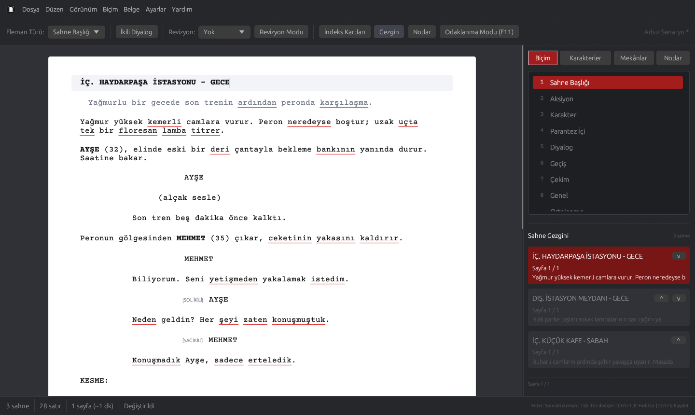
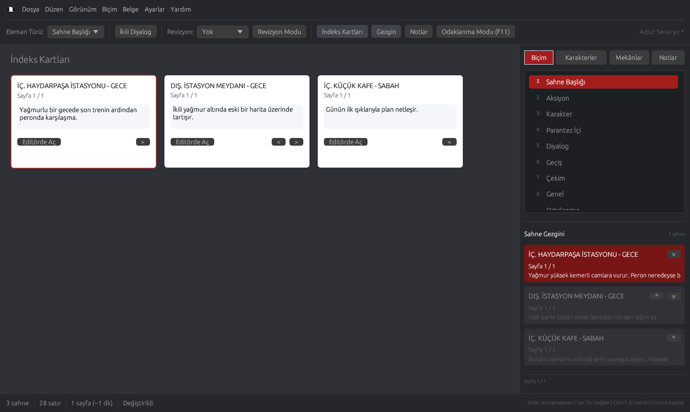
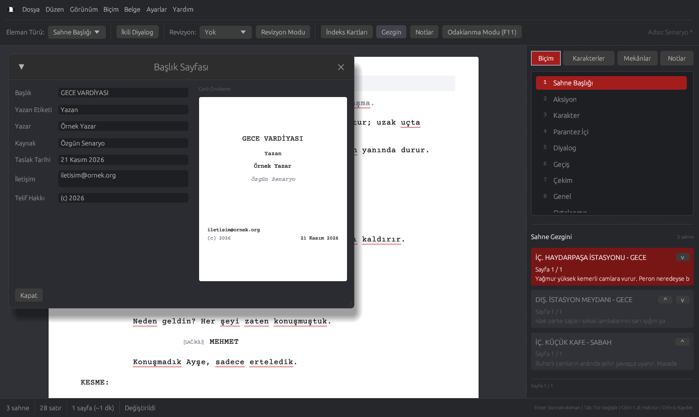
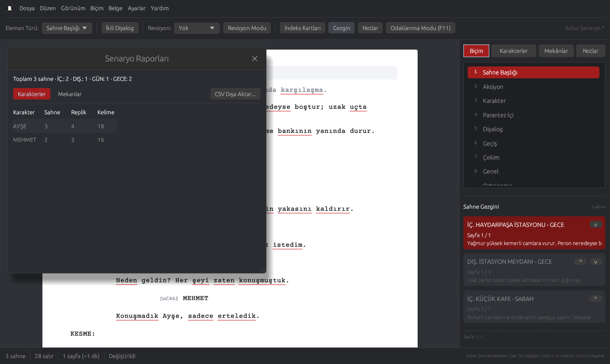
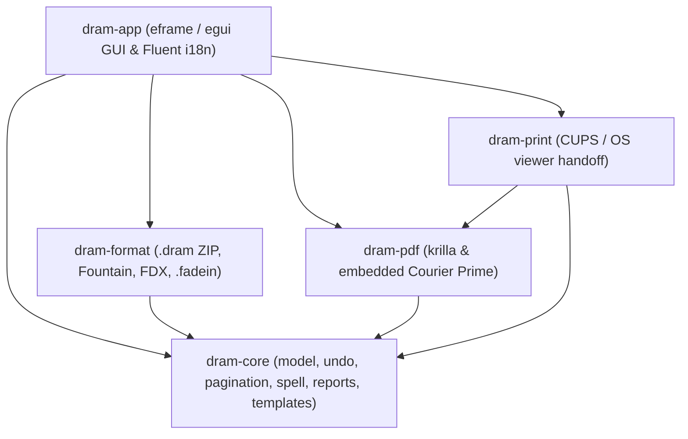

English | [Türkçe](README.tr.md)

<div align="center">
  
  <h1>draM.</h1>
  <p>A pure-Rust desktop screenplay writing application with first-class Turkish and English formatting, pagination, and PDF export.</p>

  <p>
    <a href="LICENSE-MIT"></a>
    <a href="https://github.com/MOzcelik14/draM/releases/latest"></a>
    <a href="https://www.rust-lang.org/"></a>
    <a href="https://github.com/MOzcelik14/draM/releases/latest"></a>
    <a href="https://github.com/MOzcelik14/draM/actions/workflows/ci.yml"></a>
    <a href="https://github.com/MOzcelik14/draM/commits/main"></a>
    <a href="https://github.com/MOzcelik14/prism-suite"></a>
  </p>

  <p>
    <a href="#overview">Overview</a>
    &middot;
    <a href="#features">Features</a>
    &middot;
    <a href="#installation">Installation</a>
    &middot;
    <a href="#getting-started">Getting Started</a>
    &middot;
    <a href="#supported-formats">Supported Formats</a>
    &middot;
    <a href="#architecture">Architecture</a>
    &middot;
    <a href="CHANGELOG.md">Changelog</a>
  </p>

  
</div>

---

## Overview

**draM.** is a cross-platform desktop screenplay editor written entirely in safe Rust (`#![forbid(unsafe_code)]`). It is designed for screenwriters, directors, and production teams who need a distraction-free workspace with accurate screenplay formatting, reliable offline storage, and publication-ready PDF output.

Unlike general-purpose text editors or web-based tools, **draM.** implements Turkish and English screenplay rules directly in its core document and pagination engine. Interface language and script language are decoupled: you can write an English script in a Turkish interface or a Turkish script in an English interface. Dotted and dotless Turkish letter casing (`İ`/`i`, `I`/`ı`), Turkish alphabetical collation, localized continuation markers (`(DEVAM)` vs `(MORE)` / `(CONT'D)`), and Linux X11/IBus Turkish input events are handled natively.

Projects are saved in the open, versioned `.dram` ZIP container format alongside embedded reference images, standalone notes, revision marks, and document settings. Built-in converters allow round-trip interchange with Fountain (`.fountain`), FDX (`.fdx`), and `.fadein` screenplay files, while the embedded Courier Prime font family guarantees consistent A4 and US Letter PDF export without external font dependencies.

---

## Highlights

- **Pure-Rust Architecture:** Built with `#![forbid(unsafe_code)]` across all five workspace crates, producing a single native desktop binary for Linux, macOS, and Windows.
- **First-Class Turkish and English Engine:** Independent UI and script languages, accurate Turkish `İ/i` and `I/ı` casing, Turkish collation for autocomplete and reports, and localized pagination rules.
- **Live Screenplay Pagination and Dual Dialogue:** Shared pagination engine powering live page-break dividers, runtime estimates, orphan/widow protection, side-by-side dual dialogue columns, and print-ready PDF export.
- **Production Planning Built In:** Index Cards (Beat Board) view, automatic Revision Mode with right-margin PDF asterisks, Character and Location breakdown reports with CSV export, and embedded reference images inside `.dram` archives.
- **Resilient Local Storage:** Atomic temporary-file-and-rename saves, 15-second periodic autosave recovery snapshots, startup crash-recovery prompt, and unsaved-changes confirmation on exit.

---

## Features

### Writing and Formatting

| Feature | Description |
| :--- | :--- |
| Keyboard-Driven Element Flow | Press `Enter` to insert the next logical screenplay element and `Tab` to cycle element types (`Scene Heading`, `Action`, `Character`, `Parenthetical`, `Dialogue`, `Transition`, `Shot`, `General`, `Centered`, `Lyrics`, `Page Break`, `Section`, `Synopsis`, `Note`). |
| Direct Element Shortcuts | Switch the focused line to any of the 8 primary screenplay element types with `Ctrl+1` through `Ctrl+8`. |
| Rich Inline Styling | Visual bold, italic, bold-italic, and underline rendering inside the editor canvas using embedded Courier Prime faces; apply `Ctrl+B`, `Ctrl+I`, or `Ctrl+U` to the selected character range or the entire element. |
| Dual Dialogue | Group consecutive dialogue blocks into side-by-side left and right columns for both pagination and PDF export. |
| Inline and Strip Autocomplete | Learns character names, scene headings, and transitions from the active script and dictionary; displayed both in the top suggestion strip and as an inline popup directly beneath the active line. |
| Pure-Rust Spellcheck | Built-in Turkish and English dictionaries with Turkish suffix stripping, automatic whitelisting of script character and location names, red underlines, right-click suggestions, and a persistent custom user dictionary. |
| Full Undo and Redo | Coalescing command stack covering text edits, inline style changes, element type switches, scene reordering, and find-and-replace batches. |
| Find and Replace | Turkish-aware case-insensitive or case-sensitive search, next-match navigation, single replacement, and replace-all operations. |

### Pagination, Layout, and Output

| Feature | Description |
| :--- | :--- |
| Live Cached Pagination | Recomputes page layout only when the document changes; displays page count, estimated runtime (1 page per minute), and dashed page-break dividers with page numbers directly on the paper sheet. |
| Orphan and Widow Protection | Prevents stranded scene headings at page bottoms, keeps character cues attached to their first dialogue line, and splits long dialogue with localized `(DEVAM)` or `(MORE)` / `(CONT'D)` markers. |
| Editor Virtualization | Automatically windows element rendering around the focused line for scripts exceeding 120 elements to keep large screenplays responsive. |
| Embedded-Font PDF Export | Pure-Rust PDF generation with embedded Courier Prime (Regular, Bold, Italic, BoldItalic), full Turkish glyph coverage, optional title page, A4 and US Letter layouts, optional scene numbers, and revision asterisks (`*`). |
| Cross-Platform Printing | Renders to temporary PDF and hands off to CUPS (`lp`/`lpr`) on Linux and macOS or the default print/PDF viewer handler on Windows, with copy count and page range options. |

### Organization and Production Tools

| Feature | Description |
| :--- | :--- |
| Index Cards (Beat Board) | Multi-column card view of all scenes with page indicators, inline `Synopsis` editing, scene reordering controls, and one-click jump back to the editor. |
| Scene Navigator and Inspector | Right-side dock with Format, Characters, Locations, and Notes tabs plus a live Scene Navigator with scene reordering and instant scroll-to-scene jumps. |
| Revision Mode | Four color-coded revision marks (`blue`, `pink`, `yellow`, `green`); when Revision Mode is active, edited and newly inserted elements are tagged automatically and printed with right-margin `*` marks in PDF export. |
| Breakdown Reports and CSV Export | Generates Character statistics (scenes, dialogue blocks, word counts) and Location statistics (`INT.`/`EXT.`, `DAY`/`NIGHT` counts) inside an in-app tabbed window with UTF-8 CSV export. |
| Notes with Embedded Images | Attach PNG or JPEG reference images (up to 10 MB each) to any note; thumbnails render inside the Notes tab, click to open a full-size preview window, and binary assets are stored inside the `.dram` ZIP archive. |
| Project Templates and Title Page Preview | Starter templates for Feature Film, Short Film, and TV Episode in both Turkish and English, plus a Title Page editor with a side-by-side live paper preview. |
| Workspace Ergonomics | Dark and light studio themes, distraction-free Focus Mode (`F11`), CLI file opening (`dram <path>`), and a persistent Recent Files menu (up to 8 entries). |

---

## Screenshots

| Main Editor Workspace | Index Cards (Beat Board) |
| :---: | :---: |
|  |  |

| Title Page Live Preview | Breakdown Reports |
| :---: | :---: |
|  |  |

---

## Installation

### Prebuilt Packages (GitHub Releases)

Download the latest release archive or installer from [GitHub Releases](https://github.com/MOzcelik14/draM/releases/latest). Every release publishes a `SHA256SUMS.txt` file for integrity verification.

| Platform | Artifact |
| :--- | :--- |
| Linux (Debian / Ubuntu x86_64) | `draM_<version>_amd64.deb` |
| Linux (Portable x86_64) | `draM-<version>-linux-x86_64.tar.gz` |
| macOS (arm64) | `draM-<version>-macos-arm64.tar.gz` |
| Windows (x86_64) | `draM-<version>-windows-x86_64.zip` |

#### Debian / Ubuntu (`.deb`)

```bash
sudo apt install ./draM_1.0.0_amd64.deb
dram
```

#### Linux Portable (`.tar.gz`)

```bash
tar -xzf draM-1.0.0-linux-x86_64.tar.gz
cd draM-1.0.0-linux-x86_64
./dram
```

#### macOS (`.tar.gz`)

```bash
tar -xzf draM-1.0.0-macos-arm64.tar.gz
cd draM-1.0.0-macos-arm64
./dram
```

#### Windows (`.zip`)

Extract `draM-1.0.0-windows-x86_64.zip` and run `dram.exe`.

#### Checksum Verification (Linux / macOS)

```bash
sha256sum -c SHA256SUMS.txt --ignore-missing
```

### Building from Source

#### Prerequisites

- Rust stable toolchain (`rustc` and `cargo`, Rust 2021 edition)
- On Debian / Ubuntu Linux, install the graphics and windowing development libraries:

```bash
sudo apt-get update
sudo apt-get install -y --no-install-recommends \
  build-essential \
  pkg-config \
  libx11-dev \
  libgl1-mesa-dev \
  libxkbcommon-dev \
  libwayland-dev
```

#### Compile and Run

```bash
git clone https://github.com/MOzcelik14/draM.git
cd draM
cargo run --release -p dram-app
```

You can also pass a script file directly on the command line:

```bash
cargo run --release -p dram-app -- path/to/script.dram
```

---

## Getting Started

1. **Launch `draM.`:** Start the application from your desktop menu or terminal (`dram`). The UI language is detected automatically from your operating system locale (`tr` or `en`) and can be switched anytime under **Settings**.
2. **Start a Blank Script or Template:** Begin typing in the initial `Scene Heading` line, or open **File -> New from Template** to start from a localized Feature Film, Short Film, or TV Episode structure.
3. **Write with Standard Flow:** Type a scene heading (for example `INT. STATION - NIGHT` or `İÇ. İSTASYON - GECE`) and press `Enter` to move automatically to `Action`. Press `Tab` on any line to cycle its element type, or press `Ctrl+1` through `Ctrl+8` to jump directly to a specific type.
4. **Style and Review:** Highlight a word and press `Ctrl+B`, `Ctrl+I`, or `Ctrl+U` for inline formatting. Right-click any red-underlined word to accept a spelling suggestion or add it to your personal dictionary.
5. **Organize Scenes and Notes:** Switch to **Index Cards** in the toolbar to reorder scenes and edit synopses visually, or open the **Notes** tab in the right dock to attach text notes and reference images.
6. **Configure Title Page and Export:** Open **Document -> Title Page...** to fill in cover details with live preview, save your project as `.dram` (`Ctrl+S`), and export a print-ready PDF via **File -> Export -> PDF...** or open **Format -> Script Reports...** for breakdown tables and CSV export.

---

## Keyboard Shortcuts

All shortcuts below are verified from `crates/dram-app/src/main.rs` and `crates/dram-app/src/editor.rs`. On macOS, `Ctrl` maps to `Cmd`.

| Shortcut | Action |
| :--- | :--- |
| `Enter` | Insert the next screenplay element according to screenplay flow |
| `Tab` | Cycle the element type of the focused line |
| `Backspace` (on empty line) | Delete the empty element and focus the previous element |
| `Ctrl+1` | Set focused element to Scene Heading |
| `Ctrl+2` | Set focused element to Action |
| `Ctrl+3` | Set focused element to Character |
| `Ctrl+4` | Set focused element to Parenthetical |
| `Ctrl+5` | Set focused element to Dialogue |
| `Ctrl+6` | Set focused element to Transition |
| `Ctrl+7` | Set focused element to Shot |
| `Ctrl+8` | Set focused element to General |
| `Ctrl+B` | Toggle bold on selected text or focused element |
| `Ctrl+I` | Toggle italic on selected text or focused element |
| `Ctrl+U` | Toggle underline on selected text or focused element |
| `ArrowUp` / `ArrowDown` | Navigate suggestions in the inline autocomplete popup |
| `Ctrl+Space` | Accept the highlighted inline autocomplete suggestion |
| `Esc` | Dismiss the inline autocomplete popup for the active line |
| `Ctrl+S` | Save current `.dram` project |
| `Ctrl+Z` | Undo last edit |
| `Ctrl+Y` or `Ctrl+Shift+Z` | Redo last undone edit |
| `Ctrl+F` | Open Find and Replace dialog |
| `Ctrl+P` | Open Print dialog |
| `F11` | Toggle distraction-free Focus Mode |

---

## Supported Formats

| Format | Extension | Import | Export | Notes |
| :--- | :--- | :---: | :---: | :--- |
| **draM. Project** | `.dram` | Yes | Yes | Versioned ZIP archive (`manifest.json`, `script.json`, `notes.json`, `settings.json`, `assets/*`). Full specification in [FORMAT.md](FORMAT.md). |
| **Fountain** | `.fountain` | Yes | Yes | Plain-text screenplay markup including title page metadata, inline styles, dual dialogue (`^`), boneyard stripping, and escapes. |
| **FDX XML** | `.fdx` | Yes | Yes | Standard XML screenplay interchange format. |
| **`.fadein` Archive** | `.fadein` | Yes | Yes | Compressed screenplay archive interchange format. |
| **PDF** | `.pdf` | No | Yes | Pure-Rust `krilla` renderer with embedded Courier Prime, A4 and US Letter profiles, title page, scene numbers, dual dialogue columns, and revision `*` marks. |
| **Breakdown CSV** | `.csv` | No | Yes | UTF-8 comma-separated Character and Location breakdown report. |

---

## Configuration and Data

**draM.** stores user state in standard per-user configuration and temporary directories without requiring elevated privileges.

| Data Type | Linux / macOS Path | Windows Path | Purpose |
| :--- | :--- | :--- | :--- |
| Recent Files List | `$XDG_CONFIG_HOME/dram/recent.txt` or `~/.config/dram/recent.txt` | `%APPDATA%\dram\recent.txt` | Stores up to 8 recently opened or saved file paths. |
| Custom User Dictionary | `$XDG_CONFIG_HOME/dram/user_dict.txt` or `~/.config/dram/user_dict.txt` | `%APPDATA%\dram\user_dict.txt` | Stores words added via the spellchecker context menu. |
| Named Project Recovery | `<project_dir>/<name>.dram.recovery` | `<project_dir>\<name>.dram.recovery` | Written every 15 seconds while dirty; removed on normal save or clean exit. |
| Unsaved Session Recovery | `<temp_dir>/dram_unsaved.dram.recovery` | `%TEMP%\dram_unsaved.dram.recovery` | Autosave snapshot for documents that have not yet been saved to disk. |
| Temporary Print PDF | `<temp_dir>/dram_print_<uuid>.pdf` | `%TEMP%\dram_print_<uuid>.pdf` | Generated on demand when printing or opening in the system PDF viewer. |

---

## System Requirements

| Component | Requirement |
| :--- | :--- |
| Operating System | Linux (x86_64, X11 or Wayland), macOS (arm64 / x86_64), or Windows 10/11 (x86_64) |
| Graphics | OpenGL-capable GPU / driver supported by `eframe` / `egui` (`libgl1-mesa-dev` on Linux) |
| Display Resolution | Minimum window size 720x480; 1280x720 or higher recommended |
| Printing (Optional) | CUPS (`lp` / `lpstat`) on Linux and macOS, or a system default PDF viewer on all platforms |
| Build Toolchain (Source Only) | Stable Rust (`rustc`, `cargo`, 2021 edition) and platform C linker/headers |

---

## Architecture

The workspace is split into five focused crates with `#![forbid(unsafe_code)]` enforced at the workspace root.

| Crate | Path | Responsibility |
| :--- | :--- | :--- |
| `dram-core` | `crates/dram-core` | UI-independent document model, undo/redo manager, pagination engine (including dual dialogue and revision flags), Turkish-aware text utilities, built-in spellchecker, templates, and breakdown reports. |
| `dram-format` | `crates/dram-format` | Versioned `.dram` ZIP reader/writer, schema migration pipeline, embedded binary asset storage, atomic saves, crash recovery, and `.fountain`, `.fdx`, and `.fadein` converters. |
| `dram-pdf` | `crates/dram-pdf` | Pure-Rust PDF generator built on `krilla` and `ttf-parser` with embedded Courier Prime fonts and Turkish glyph validation. |
| `dram-print` | `crates/dram-print` | Cross-platform printing handoff via temporary PDF generation, CUPS printer discovery on Unix, and default viewer fallback. |
| `dram-app` | `crates/dram-app` | Native desktop GUI built on `eframe`/`egui`, custom screenplay editor canvas, Beat Board, inspector dock, reports dialog, theme/typography configuration, and Fluent localization. |



---

## Roadmap

All 12 planned items tracked in [ROADMAP.md](ROADMAP.md) have been completed and released in `v1.0.0`. Future enhancements will be tracked via GitHub Issues and documented in [CHANGELOG.md](CHANGELOG.md) as new milestones are scoped.

---

## FAQ and Troubleshooting

**1. Turkish characters (`ü`, `ş`, `ğ`, `ı`, `İ`, `ö`, `ç`) do not type properly on Linux.**
`dram-app` includes an X11/IBus IME normalization pass (`normalize_linux_ime_events`) that converts orphaned `ImeEvent::Commit` events into text events. Ensure your system input method is active and that you are running `v1.0.0` or later.

**2. Can I write an English script while keeping the Turkish interface (or vice versa)?**
Yes. Interface language (**Settings -> Interface Language**) and script language (**Settings -> Script Language**) are completely independent. Script language controls uppercase conventions, continuation markers (`(DEVAM)` vs `(MORE)`/`(CONT'D)`), autocomplete prefixes, and spellcheck dictionaries.

**3. Printing fails or no printers appear in the Print dialog.**
On Linux and macOS, printer listing uses `lpstat -p` and printing uses `lp` (CUPS). If CUPS is not installed or no printer is configured, click **Open in PDF Viewer** inside the Print dialog to inspect and print from your system's default PDF application.

**4. Where are my attached reference images stored when I move a `.dram` file?**
Attached PNG and JPEG images are embedded directly inside the `.dram` ZIP archive under `assets/`. Moving or sharing the `.dram` file carries all attached reference images with it. Individual images are capped at 10 MB.

**5. The spellchecker underlines a character name or invented location.**
Character names and scene heading terms from the current document are whitelisted automatically. For other proper nouns or domain-specific words, right-click the underlined word and select **Add to Dictionary**; it is persisted to your `user_dict.txt` file.

**6. The application closed unexpectedly. How do I recover my work?**
While a document has unsaved changes, **draM.** writes a `.recovery` snapshot every 15 seconds. On the next launch (or when reopening the same `.dram` file), a recovery dialog prompts you to **Recover** or **Discard** the snapshot.

---

## Development

### Common Commands

```bash
# Check formatting
cargo fmt --all -- --check

# Run Clippy with warnings denied
cargo clippy --workspace --all-targets -- -D warnings

# Run all workspace unit and integration tests
cargo test --workspace --locked

# Build release binaries
cargo build --workspace --release --locked

# Package Linux portable tar.gz and Debian .deb artifacts
bash scripts/package-linux.sh
```

### Commit Convention

The repository follows conventional commit prefixes observed in git history: `feat:`, `fix:`, `docs:`, `chore:`, `ci:`, and scoped variants such as `fix(ui):`.

### Repository Layout

```text
draM/
├── .github/workflows/   # CI, Release, and GitHub Pages workflows
├── assets/              # Embedded Courier Prime TTF fonts and SVG logo marks
├── crates/
│   ├── dram-app/        # Desktop GUI binary (dram)
│   ├── dram-core/       # Core screenplay model, pagination, spellcheck, reports, templates
│   ├── dram-format/     # .dram archive and interchange format converters
│   ├── dram-pdf/        # Pure-Rust PDF exporter and pipeline integration tests
│   └── dram-print/      # Cross-platform print handoff
├── docs/                # Project website and docs/images/ screenshot folder
├── locales/             # Fluent translation bundles (en, tr)
├── scripts/             # Linux packaging helper script
├── CHANGELOG.md
├── FORMAT.md
├── ROADMAP.md
├── LICENSE-APACHE
└── LICENSE-MIT
```

---

## Contributing

Contributions are welcome. Please read [CONTRIBUTING.md](CONTRIBUTING.md) for full guidelines, or follow this summary workflow:

1. Fork the repository and create a feature or bugfix branch from `main`.
2. Preserve `#![forbid(unsafe_code)]` across all crates and route all user-facing UI strings through `locales/en/main.ftl` and `locales/tr/main.ftl` with matching keys.
3. Run `cargo fmt --all -- --check`, `cargo clippy --workspace --all-targets -- -D warnings`, and `cargo test --workspace` before opening a pull request.
4. Keep pull requests focused and include unit or integration tests for new behavior.

---

## Localization

**draM.** uses Project Fluent (`.ftl`) bundles for UI localization. Currently supported interface languages:

- **English (`en`):** [locales/en/main.ftl](locales/en/main.ftl)
- **Turkish (`tr`):** [locales/tr/main.ftl](locales/tr/main.ftl)

Unit tests in `crates/dram-app/src/i18n.rs` (`tr_and_en_bundles_have_matching_message_keys`) verify that all translation bundles keep identical key sets, and `ui_sources_contain_no_hardcoded_user_labels` guards against hardcoded UI labels.

To add a new interface language:
1. Create `locales/<lang>/main.ftl` copying all keys from `locales/en/main.ftl`.
2. Register the new variant in `UiLanguage` inside `crates/dram-app/src/i18n.rs` and include the `.ftl` file via `include_str!`.
3. Add a menu option under **Settings -> Interface Language** in `crates/dram-app/src/main.rs` and extend the key-parity test.

---

## License

**draM.** is dual-licensed under either:

- **MIT License** ([LICENSE-MIT](LICENSE-MIT))
- **Apache License, Version 2.0** ([LICENSE-APACHE](LICENSE-APACHE))

at your option.

The embedded **Courier Prime** font family (`assets/fonts/`) is licensed under the **SIL Open Font License 1.1**.

---

## Acknowledgements

**draM.** relies on the following open-source Rust crates and assets:

| Component | License | Usage |
| :--- | :--- | :--- |
| `eframe` / `egui` | MIT OR Apache-2.0 | Native cross-platform desktop UI framework |
| `krilla` | Apache-2.0 | Pure-Rust PDF generation |
| `ttf-parser` | MIT OR Apache-2.0 | Embedded TrueType glyph validation |
| `fluent-bundle` / `unic-langid` / `sys-locale` | MIT OR Apache-2.0 | Localization and system locale detection |
| `serde` / `serde_json` | MIT OR Apache-2.0 | JSON serialization for `.dram` archives |
| `zip` | MIT | `.dram` and `.fadein` ZIP container handling |
| `quick-xml` | MIT | `.fdx` and `.fadein` XML parsing and serialization |
| `image` | MIT OR Apache-2.0 | Pure-Rust PNG and JPEG decoding for note reference images |
| `rfd` | MIT | Native OS file open/save dialogs |
| `unicode-segmentation` | MIT OR Apache-2.0 | Unicode grapheme and word boundary handling |
| `chrono` / `uuid` / `thiserror` / `anyhow` | MIT OR Apache-2.0 | Timestamps, identifiers, and error handling |
| Courier Prime | SIL OFL 1.1 | Screenplay monospace typography |

---

## Contact

- **Repository:** [github.com/MOzcelik14/draM](https://github.com/MOzcelik14/draM)
- **Issue Tracker:** [github.com/MOzcelik14/draM/issues](https://github.com/MOzcelik14/draM/issues)
- **Releases:** [github.com/MOzcelik14/draM/releases](https://github.com/MOzcelik14/draM/releases)
- **Suite:** [github.com/MOzcelik14/prism-suite](https://github.com/MOzcelik14/prism-suite)

---

<div align="center">
  Part of the <a href="https://github.com/MOzcelik14/prism-suite">prisM. Suite</a>
</div>
