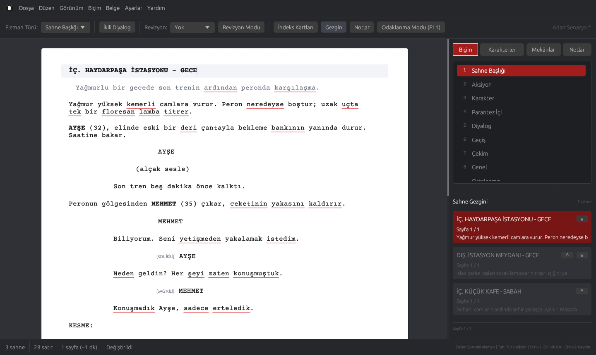
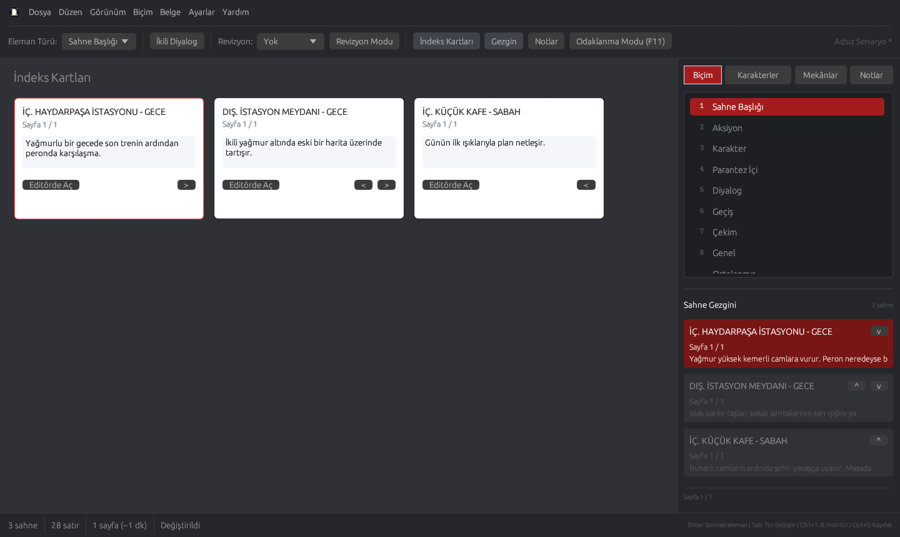
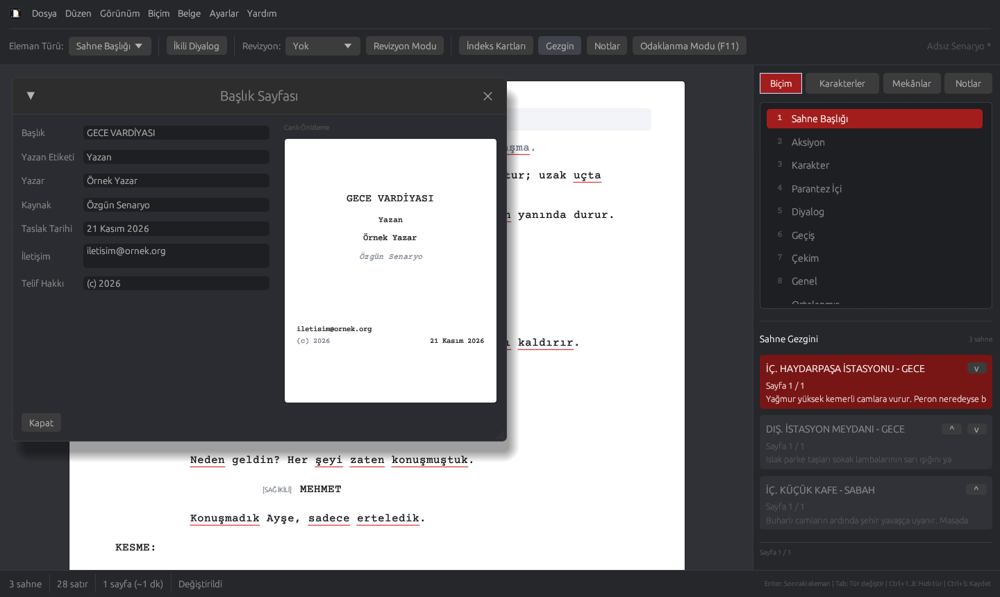
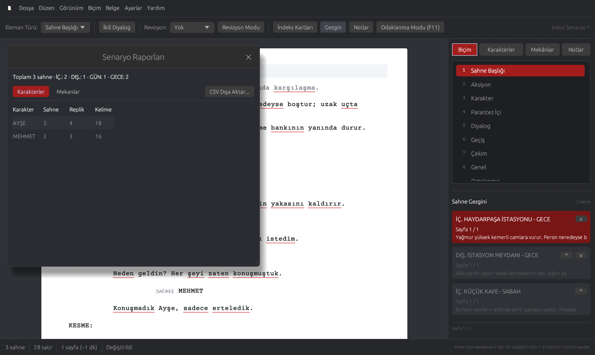
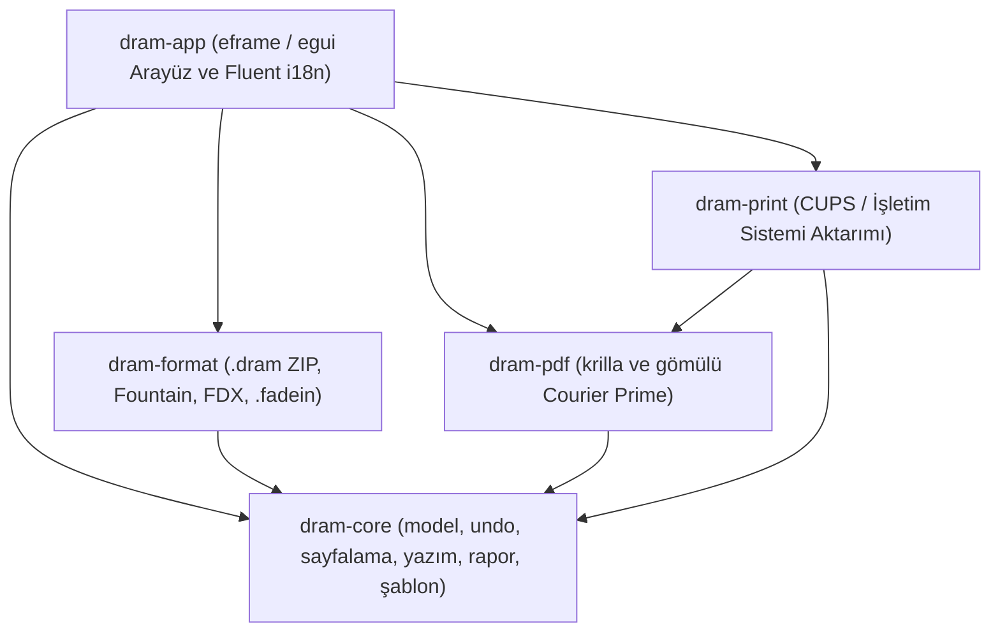

[English](README.md) | Türkçe

<div align="center">
  
  <h1>draM.</h1>
  <p>Türkçe ve İngilizce senaryo kuralları, canlı sayfalama ve PDF çıktısı sunan saf Rust masaüstü senaryo yazım uygulaması.</p>

  <p>
    <a href="LICENSE-MIT"></a>
    <a href="https://github.com/MOzcelik14/draM/releases/latest"></a>
    <a href="https://www.rust-lang.org/"></a>
    <a href="https://github.com/MOzcelik14/draM/releases/latest"></a>
    <a href="https://github.com/MOzcelik14/draM/actions/workflows/ci.yml"></a>
    <a href="https://github.com/MOzcelik14/draM/commits/main"></a>
    <a href="https://github.com/MOzcelik14/prism-suite"></a>
  </p>

  <p>
    <a href="#genel-bakış">Genel Bakış</a>
    &middot;
    <a href="#özellikler">Özellikler</a>
    &middot;
    <a href="#kurulum">Kurulum</a>
    &middot;
    <a href="#başlarken">Başlarken</a>
    &middot;
    <a href="#desteklenen-formatlar">Desteklenen Formatlar</a>
    &middot;
    <a href="#mimari">Mimari</a>
    &middot;
    <a href="CHANGELOG.md">Değişiklik Günlüğü</a>
  </p>

  
</div>

---

## Genel Bakış

**draM.**, tamamen güvenli Rust (`#![forbid(unsafe_code)]`) ile geliştirilmiş çoklu platform bir masaüstü senaryo yazım uygulamasıdır. Dikkat dağıtmayan bir çalışma alanı, tutarlı senaryo biçimlendirmesi, güvenilir çevrimdışı depolama ve baskıya hazır PDF çıktısı arayan senaristler, yönetmenler ve yapım ekipleri için tasarlanmıştır.

Genel amaçlı metin düzenleyicilerin aksine **draM.**, Türkçe ve İngilizce senaryo kurallarını doğrudan çekirdek belge ve sayfalama motorunda uygular. Arayüz dili ile senaryo dili birbirinden bağımsızdır: Türkçe arayüzle İngilizce senaryo veya İngilizce arayüzle Türkçe senaryo yazabilirsiniz. Türkçe noktalı/noktasız harf dönüşümleri (`İ`/`i`, `I`/`ı`), Türkçe alfabe sıralaması, yerelleştirilmiş devam işaretleri (`(DEVAM)` ve `(MORE)` / `(CONT'D)`) ile Linux X11/IBus Türkçe giriş olayları yerel olarak işlenir.

Projeler; gömülü referans görselleri, bağımsız notlar, revizyon işaretleri ve belge ayarlarıyla birlikte açık ve sürümlü `.dram` ZIP konteyner formatında saklanır. Yerleşik dönüştürücüler Fountain (`.fountain`), FDX (`.fdx`) ve `.fadein` dosyalarıyla çift yönlü veri alışverişi sağlarken, gömülü Courier Prime yazı tipi ailesi harici yazı tipi kurulumu gerektirmeden A4 ve US Letter PDF çıktısı üretir.

---

## Öne Çıkanlar

- **Saf Rust Mimarisi:** Beş çalışma alanı paketinin tamamında `#![forbid(unsafe_code)]` uygulanır; Linux, macOS ve Windows için tek bir yerel masaüstü ikili dosyası üretilir.
- **Birinci Sınıf Türkçe ve İngilizce Motoru:** Bağımsız arayüz ve senaryo dilleri, hatasız `İ/i` ve `I/ı` büyük/küçük harf dönüşümü, otomatik tamamlama ve raporlarda Türkçe sıralama ile yerel sayfalama kuralları.
- **Canlı Sayfalama ve İkili Diyalog:** Canlı sayfa sonu ayraçlarını, tahmini süreyi, yetim/dul satır korumasını, yan yana ikili diyalog sütunlarını ve baskıya hazır PDF çıktısını besleyen ortak sayfalama motoru.
- **Yerleşik Yapım Araçları:** İndeks Kartları (Beat Board) görünümü, PDF sağ kenar yıldızlı otomatik Revizyon Modu, CSV dışa aktarımlı Karakter ve Mekân raporları ve `.dram` arşivine gömülü referans görselleri.
- **Dayanıklı Yerel Depolama:** Geçici dosya ve atomik yeniden adlandırma ile kayıt, 15 saniyede bir otomatik kurtarma kopyası, açılışta çökme kurtarma uyarısı ve kaydedilmemiş değişikliklerle çıkış onayı.

---

## Özellikler

### Yazım ve Biçimlendirme

| Özellik | Açıklama |
| :--- | :--- |
| Klavye Odaklı Eleman Akışı | `Enter` tuşuyla bir sonraki mantıksal senaryo elemanını ekler, `Tab` tuşuyla eleman türleri arasında geçiş yapar (`Sahne Başlığı`, `Aksiyon`, `Karakter`, `Parantez İçi`, `Diyalog`, `Geçiş`, `Çekim`, `Genel`, `Ortalanmış`, `Şarkı Sözü`, `Sayfa Sonu`, `Bölüm`, `Özet`, `Not`). |
| Doğrudan Eleman Kısayolları | `Ctrl+1` ile `Ctrl+8` arasında tek tuşla 8 temel senaryo eleman türüne geçiş yapar. |
| Zengin Satır İçi Biçimlendirme | Gömülü Courier Prime (Regular, Bold, Italic, BoldItalic) yazı tipleriyle kalın, italik ve altı çizili stiller editör kağıdında görsel olarak işlenir; `Ctrl+B`, `Ctrl+I` ve `Ctrl+U` seçili karakter aralığına veya tüm elemana uygulanır. |
| İkili Diyalog | Ardışık diyalog bloklarını hem sayfalamada hem de PDF çıktısında yan yana sol ve sağ sütunlar halinde gruplar. |
| Satır İçi ve Üst Öneri Tamamlama | Belgedeki karakter adlarını, sahne başlıklarını ve geçişleri öğrenir; önerileri hem üst şeritte hem de odaklı satırın hemen altında açılır listede sunar. |
| Saf Rust Yazım Denetimi | Türkçe ek soyucu destekli dahili Türkçe ve İngilizce sözlükler, belgedeki karakter ve mekân adlarının otomatik beyaz listelenmesi, kırmızı alt çizgi, sağ tık önerileri ve kalıcı kullanıcı sözlüğü. |
| Geri Alma ve Yineleme | Metin düzenlemeleri, satır içi stil değişiklikleri, eleman türü geçişleri, sahne sırası değişiklikleri ve toplu bul-değiştir işlemlerini kapsayan birleştirmeli komut geçmişi. |
| Bul ve Değiştir | Türkçe harf kurallarına duyarlı büyük/küçük harf duyarsız veya duyarlı arama, sonraki eşleşmeye atlama, tekli ve toplu değiştirme. |

### Sayfalama, Yerleşim ve Çıktı

| Özellik | Açıklama |
| :--- | :--- |
| Önbellekli Canlı Sayfalama | Sayfa düzenini yalnızca belge değiştiğinde yeniden hesaplar; sayfa sayısını, tahmini süreyi (sayfa başına yaklaşık 1 dakika) ve kağıt üzerinde kesikli sayfa sonu ayraçlarıyla sayfa numaralarını gösterir. |
| Yetim ve Dul Satır Koruması | Sayfa altında tek başına sahne başlığı kalmasını engeller, karakter adını ilk diyalog satırına bağlı tutar ve uzun diyalogları yerel `(DEVAM)` veya `(MORE)` / `(CONT'D)` işaretleriyle böler. |
| Editör Sanallaştırması | 120 elemandan uzun senaryolarda odaklı satır çevresinde pencereleme uygulayarak uzun metinlerde akıcılığı korur. |
| Gömülü Yazı Tipli PDF Çıktısı | Gömülü Courier Prime ailesi, tam Türkçe glif doğrulaması, isteğe bağlı başlık sayfası, A4 ve US Letter profilleri, sahne numaraları ve revizyon `*` işaretleriyle saf Rust PDF üretimi. |
| Çoklu Platform Yazdırma | Belgeyi geçici PDF olarak işler; Linux ve macOS'ta CUPS (`lp`/`lpr`), Windows'ta sistem yazdırma/PDF görüntüleyici üzerinden kopya sayısı ve sayfa aralığı seçenekleriyle yazdırır. |

### Organizasyon ve Yapım Araçları

| Özellik | Açıklama |
| :--- | :--- |
| İndeks Kartları (Beat Board) | Tüm sahneleri sayfa bilgisi, doğrudan düzenlenebilir `Özet` (`Synopsis`) alanı, sahne taşıma düğmeleri ve editörde açma kısayoluyla çok sütunlu kartlar halinde gösterir. |
| Sahne Gezgini ve Sağ Panel | Biçim, Karakterler, Mekânlar ve Notlar sekmelerinin altında sahne sırası değiştirme ve ilgili satıra doğrudan kaydırma özellikli Sahne Gezgini. |
| Revizyon Modu | Dört renkli revizyon işareti (`mavi`, `pembe`, `sarı`, `yeşil`); Revizyon Modu açıkken değiştirilen ve yeni eklenen satırlar otomatik işaretlenir ve PDF çıktıda sağ kenara `*` basılır. |
| Senaryo Raporları ve CSV Aktarımı | Karakter istatistiklerini (sahne, replik, kelime sayısı) ve mekân istatistiklerini (`İÇ.`/`DIŞ.`, `GÜN`/`GECE` dağılımı) sekmeli pencerede sunar ve UTF-8 CSV olarak dışa aktarır. |
| Gömülü Görselli Notlar | Her nota 10 MB'a kadar PNG veya JPEG referans görseli eklenebilir; küçük önizleme Notlar sekmesinde görünür, tıklandığında tam boy önizleme açılır ve görseller `.dram` ZIP arşivine gömülür. |
| Proje Şablonları ve Kapak Önizlemesi | Türkçe ve İngilizce Uzun Metraj Film, Kısa Film ve Dizi Bölümü başlangıç şablonları ile Başlık Sayfası düzenleyicisinde yan yana canlı kağıt önizlemesi. |
| Çalışma Alanı Ergonomisi | Koyu ve açık stüdyo temaları, `F11` Odaklanma Modu, komut satırından dosya açma (`dram <dosya>`) ve kalıcı Son Kullanılanlar listesi (en fazla 8 kayıt). |

---

## Ekran Görüntüleri

| Ana Editör Çalışma Alanı | İndeks Kartları (Beat Board) |
| :---: | :---: |
|  |  |

| Başlık Sayfası Canlı Önizleme | Senaryo Raporları |
| :---: | :---: |
|  |  |

---

## Kurulum

### Hazır Paketler (GitHub Releases)

En güncel sürüm paketlerini [GitHub Releases](https://github.com/MOzcelik14/draM/releases/latest) sayfasından indirebilirsiniz. Her sürümde doğrulama için `SHA256SUMS.txt` dosyası yayınlanır.

| Platform | Paket |
| :--- | :--- |
| Linux (Debian / Ubuntu x86_64) | `draM_<sürüm>_amd64.deb` |
| Linux (Taşınabilir x86_64) | `draM-<sürüm>-linux-x86_64.tar.gz` |
| macOS (arm64) | `draM-<sürüm>-macos-arm64.tar.gz` |
| Windows (x86_64) | `draM-<sürüm>-windows-x86_64.zip` |

#### Debian / Ubuntu (`.deb`)

```bash
sudo apt install ./draM_1.0.0_amd64.deb
dram
```

#### Linux Taşınabilir (`.tar.gz`)

```bash
tar -xzf draM-1.0.0-linux-x86_64.tar.gz
cd draM-1.0.0-linux-x86_64
./dram
```

#### macOS (`.tar.gz`)

```bash
tar -xzf draM-1.0.0-macos-arm64.tar.gz
cd draM-1.0.0-macos-arm64
./dram
```

#### Windows (`.zip`)

`draM-1.0.0-windows-x86_64.zip` arşivini açın ve `dram.exe` dosyasını çalıştırın.

#### Sağlama Toplamı Doğrulaması (Linux / macOS)

```bash
sha256sum -c SHA256SUMS.txt --ignore-missing
```

### Kaynaktan Derleme

#### Ön Koşullar

- Kararlı Rust araç zinciri (`rustc` ve `cargo`, Rust 2021 sürümü)
- Debian / Ubuntu Linux üzerinde grafik ve pencere geliştirme kütüphaneleri:

```bash
sudo apt-get update
sudo apt-get install -y --no-install-recommends \
  build-essential \
  pkg-config \
  libx11-dev \
  libgl1-mesa-dev \
  libxkbcommon-dev \
  libwayland-dev
```

#### Derleme ve Çalıştırma

```bash
git clone https://github.com/MOzcelik14/draM.git
cd draM
cargo run --release -p dram-app
```

Komut satırından doğrudan bir senaryo dosyası açabilirsiniz:

```bash
cargo run --release -p dram-app -- yol/senaryo.dram
```

---

## Başlarken

1. **`draM.` Uygulamasını Başlatın:** Uygulamayı masaüstü menüsünden veya terminalden (`dram`) açın. Arayüz dili işletim sistemi dilinden otomatik algılanır (`tr` veya `en`) ve **Ayarlar** menüsünden istendiği zaman değiştirilebilir.
2. **Boş Belge veya Şablon Seçin:** İlk `Sahne Başlığı` satırından doğrudan yazmaya başlayabilir veya **Dosya -> Şablondan Yeni** alt menüsünden Uzun Metraj Film, Kısa Film ya da Dizi Bölümü şablonlarından birini açabilirsiniz.
3. **Standart Akışla Yazın:** Bir sahne başlığı yazın (örneğin `İÇ. İSTASYON - GECE`) ve `Enter` tuşuna basarak otomatik olarak `Aksiyon` satırına geçin. Bulunduğunuz satırın türünü değiştirmek için `Tab` tuşunu veya `Ctrl+1`–`Ctrl+8` kısayollarını kullanın.
4. **Biçimlendirin ve Denetleyin:** Bir kelimeyi seçip `Ctrl+B`, `Ctrl+I` veya `Ctrl+U` ile kalın, italik veya altı çizili yapın. Altı kırmızı çizili bir kelimeye sağ tıklayarak önerilerden birini seçin veya sözlüğünüze ekleyin.
5. **Sahneleri ve Notları Düzenleyin:** Araç çubuğundan **İndeks Kartları** görünümüne geçerek sahne sırasını ve özetlerini görsel olarak düzenleyin veya sağ paneldeki **Notlar** sekmesinden referans görselli notlar ekleyin.
6. **Başlık Sayfasını Hazırlayın ve Dışa Aktarın:** **Belge -> Başlık Sayfası...** penceresinde canlı önizlemeyle kapak bilgilerini doldurun, projenizi `.dram` olarak kaydedin (`Ctrl+S`), **Dosya -> Dışa Aktar -> PDF...** ile baskıya hazır PDF alın veya **Biçim -> Senaryo Raporları...** ile karakter ve mekân dağılımını CSV olarak dışa aktarın.

---

## Klavye Kısayolları

Aşağıdaki tüm kısayollar `crates/dram-app/src/main.rs` ve `crates/dram-app/src/editor.rs` dosyalarından doğrulanmıştır. macOS üzerinde `Ctrl` tuşu `Cmd` olarak çalışır.

| Kısayol | İşlev |
| :--- | :--- |
| `Enter` | Senaryo akışına göre bir sonraki eleman türünü ekler |
| `Tab` | Odaklı satırın eleman türünü sıradaki türe geçirir |
| `Backspace` (boş satırda) | Boş elemanı siler ve önceki elemana odaklanır |
| `Ctrl+1` | Odaklı elemanı Sahne Başlığı yapar |
| `Ctrl+2` | Odaklı elemanı Aksiyon yapar |
| `Ctrl+3` | Odaklı elemanı Karakter yapar |
| `Ctrl+4` | Odaklı elemanı Parantez İçi yapar |
| `Ctrl+5` | Odaklı elemanı Diyalog yapar |
| `Ctrl+6` | Odaklı elemanı Geçiş yapar |
| `Ctrl+7` | Odaklı elemanı Çekim yapar |
| `Ctrl+8` | Odaklı elemanı Genel yapar |
| `Ctrl+B` | Seçili metinde veya odaklı elemanda kalın stilini açar/kapatır |
| `Ctrl+I` | Seçili metinde veya odaklı elemanda italik stilini açar/kapatır |
| `Ctrl+U` | Seçili metinde veya odaklı elemanda altı çizili stilini açar/kapatır |
| `Yukarı` / `Aşağı` | Satır içi otomatik tamamlama önerileri arasında gezinir |
| `Ctrl+Space` | Satır içi otomatik tamamlamada seçili öneriyi uygular |
| `Esc` | Aktif satır için otomatik tamamlama açılır penceresini kapatır |
| `Ctrl+S` | Mevcut `.dram` projesini kaydeder |
| `Ctrl+Z` | Son işlemi geri alır |
| `Ctrl+Y` veya `Ctrl+Shift+Z` | Geri alınan işlemi yineler |
| `Ctrl+F` | Bul ve Değiştir penceresini açar |
| `Ctrl+P` | Yazdırma penceresini açar |
| `F11` | Odaklanma Modunu açar veya kapatır |

---

## Desteklenen Formatlar

| Format | Uzantı | İçe Aktarma | Dışa Aktarma | Açıklama |
| :--- | :--- | :---: | :---: | :--- |
| **draM. Projesi** | `.dram` | Evet | Evet | Sürümlü ZIP arşivi (`manifest.json`, `script.json`, `notes.json`, `settings.json`, `assets/*`). Ayrıntılı şema: [FORMAT.md](FORMAT.md). |
| **Fountain** | `.fountain` | Evet | Evet | Başlık sayfası, satır içi stiller, ikili diyalog (`^`), açıklama ayıklama ve kaçış karakterleri destekli düz metin formatı. |
| **FDX XML** | `.fdx` | Evet | Evet | XML tabanlı senaryo değişim formatı. |
| **`.fadein` Arşivi** | `.fadein` | Evet | Evet | Sıkıştırılmış senaryo arşivi değişim formatı. |
| **PDF** | `.pdf` | Hayır | Evet | Gömülü Courier Prime, A4 ve US Letter profilleri, başlık sayfası, sahne numaraları, ikili diyalog sütunları ve revizyon `*` işaretli saf Rust `krilla` çıktısı. |
| **Dağılım Raporu (CSV)** | `.csv` | Hayır | Evet | UTF-8 kodlamalı karakter ve mekân dağılım raporu. |

---

## Yapılandırma ve Veri Dizinleri

**draM.**, kullanıcı verilerini yönetici izni gerektirmeden standart kullanıcı yapılandırma ve geçici dizinlerinde saklar.

| Veri Türü | Linux / macOS Yolu | Windows Yolu | Amaç |
| :--- | :--- | :--- | :--- |
| Son Kullanılanlar | `$XDG_CONFIG_HOME/dram/recent.txt` veya `~/.config/dram/recent.txt` | `%APPDATA%\dram\recent.txt` | Son açılan veya kaydedilen en fazla 8 dosya yolunu tutar. |
| Özel Kullanıcı Sözlüğü | `$XDG_CONFIG_HOME/dram/user_dict.txt` veya `~/.config/dram/user_dict.txt` | `%APPDATA%\dram\user_dict.txt` | Yazım denetimi sağ tık menüsüyle eklenen kelimeleri saklar. |
| Kayıtlı Proje Kurtarma | `<proje_dizini>/<ad>.dram.recovery` | `<proje_dizini>\<ad>.dram.recovery` | Belge kirliyken 15 saniyede bir yazılır; normal kayıtta veya temiz kapanışta silinir. |
| Kaydedilmemiş Oturum Kurtarma | `<temp_dir>/dram_unsaved.dram.recovery` | `%TEMP%\dram_unsaved.dram.recovery` | Henüz diske kaydedilmemiş belgeler için otomatik kurtarma kopyası. |
| Geçici Yazdırma PDF Dosyası | `<temp_dir>/dram_print_<uuid>.pdf` | `%TEMP%\dram_print_<uuid>.pdf` | Yazdırma veya sistem PDF görüntüleyicisinde açma sırasında oluşturulur. |

---

## Sistem Gereksinimleri

| Bileşen | Gereksinim |
| :--- | :--- |
| İşletim Sistemi | Linux (x86_64, X11 veya Wayland), macOS (arm64 / x86_64) veya Windows 10/11 (x86_64) |
| Grafik | `eframe` / `egui` tarafından desteklenen OpenGL uyumlu grafik sürücüsü (Linux'ta `libgl1-mesa-dev`) |
| Ekran Çözünürlüğü | En az 720x480 pencere boyutu; 1280x720 ve üzeri önerilir |
| Yazdırma (İsteğe Bağlı) | Linux ve macOS'ta CUPS (`lp` / `lpstat`) veya tüm platformlarda varsayılan PDF görüntüleyici |
| Derleme Araçları (Yalnızca Kaynaktan) | Kararlı Rust (`rustc`, `cargo`, 2021 sürümü) ve platform C bağlayıcı/başlık paketleri |

---

## Mimari

Çalışma alanı, kök manifestoda `#![forbid(unsafe_code)]` zorunlu tutulan beş odaklanmış pakete ayrılmıştır.

| Paket | Yol | Sorumluluk |
| :--- | :--- | :--- |
| `dram-core` | `crates/dram-core` | Arayüzden bağımsız belge modeli, geri alma/yineleme yöneticisi, sayfalama motoru (ikili diyalog ve revizyon bayrakları dahil), Türkçe metin yardımcıları, dahili yazım denetimi, şablonlar ve senaryo raporları. |
| `dram-format` | `crates/dram-format` | Sürümlü `.dram` ZIP okuyucu/yazıcı, şema migrasyon hattı, gömülü ikili medya depolama, atomik kayıt, çökme kurtarma ile `.fountain`, `.fdx` ve `.fadein` dönüştürücüleri. |
| `dram-pdf` | `crates/dram-pdf` | `krilla` ve `ttf-parser` tabanlı, gömülü Courier Prime yazı tipli ve Türkçe glif doğrulamalı saf Rust PDF üreticisi. |
| `dram-print` | `crates/dram-print` | Geçici PDF üretimi üzerinden çoklu platform yazdırma aktarımı, Unix sistemlerde CUPS yazıcı listeleme ve varsayılan görüntüleyici yedeği. |
| `dram-app` | `crates/dram-app` | `eframe`/`egui` tabanlı yerel masaüstü arayüzü, özel senaryo editörü tuvali, İndeks Kartları, sağ panel, rapor penceresi, tema/tipografi ve Fluent yerelleştirme. |



---

## Yol Haritası

[ROADMAP.md](ROADMAP.md) dosyasında planlanan 12 maddenin tamamı `v1.0.0` sürümünde tamamlanarak yayınlanmıştır. Yeni sürümler için planlanacak özellikler GitHub Issues üzerinden izlenecek ve [CHANGELOG.md](CHANGELOG.md) dosyasında belgelenecektir.

---

## Sık Sorulan Sorular ve Sorun Giderme

**1. Linux sistemde Türkçe karakterler (`ü`, `ş`, `ğ`, `ı`, `İ`, `ö`, `ç`) yazılmıyor.**
`dram-app`, X11/IBus ortamında yetim `ImeEvent::Commit` olaylarını metin olayına dönüştüren `normalize_linux_ime_events` katmanını içerir. Sistem giriş yönteminizin etkin olduğundan ve `v1.0.0` veya sonraki bir sürümü kullandığınızdan emin olun.

**2. Türkçe arayüz kullanırken İngilizce senaryo (veya tersi) yazabilir miyim?**
Evet. Arayüz dili (**Ayarlar -> Arayüz Dili**) ve senaryo dili (**Ayarlar -> Senaryo Dili**) birbirinden tamamen bağımsızdır. Senaryo dili büyük/küçük harf kurallarını, devam işaretlerini (`(DEVAM)` veya `(MORE)`/`(CONT'D)`), otomatik tamamlama ön eklerini ve yazım denetimi sözlüğünü belirler.

**3. Yazdırma başarısız oluyor veya yazıcı listesi boş görünüyor.**
Linux ve macOS'ta yazıcı listeleme `lpstat -p`, yazdırma ise `lp` (CUPS) komutlarını kullanır. CUPS kurulu değilse veya tanımlı yazıcı yoksa Yazdırma penceresindeki **PDF Görüntüleyicide Aç** düğmesiyle sisteminizin varsayılan PDF uygulamasından yazdırabilirsiniz.

**4. Notlara eklediğim referans görselleri `.dram` dosyasını başka bilgisayara taşıdığımda kaybolur mu?**
Hayır. Eklenen PNG ve JPEG görseller doğrudan `.dram` ZIP arşivinin `assets/` klasörüne gömülür. Dosyayı taşıdığınızda veya paylaştığınızda görseller belgeyle birlikte taşınır. Tek bir görsel için üst sınır 10 MB olarak belirlenmiştir.

**5. Yazım denetimi bir karakter adını veya kurgusal bir yer adını hatalı işaretliyor.**
Belgedeki karakter adları ve sahne başlığı kelimeleri otomatik olarak beyaz listeye alınır. Diğer özel isimler veya terimler için altı çizili kelimeye sağ tıklayıp **Sözlüğe Ekle** seçeneğini kullanabilirsiniz; kelime kalıcı `user_dict.txt` dosyanıza kaydedilir.

**6. Uygulama beklenmedik şekilde kapandı, çalışmamı nasıl kurtarırım?**
Kaydedilmemiş değişiklikler varken **draM.** her 15 saniyede bir `.recovery` kopyası alır. Uygulamayı yeniden açtığınızda (veya ilgili `.dram` dosyasını açtığınızda) **Kurtar** veya **Yoksay** seçeneklerini sunan kurtarma penceresi görüntülenir.

---

## Geliştirme

### Temel Komutlar

```bash
# Kod biçimlendirmesini kontrol et
cargo fmt --all -- --check

# Clippy denetimini uyarıları hata sayarak çalıştır
cargo clippy --workspace --all-targets -- -D warnings

# Tüm çalışma alanı birim ve entegrasyon testlerini çalıştır
cargo test --workspace --locked

# Release ikili dosyalarını derle
cargo build --workspace --release --locked

# Linux taşınabilir tar.gz ve Debian .deb paketlerini oluştur
bash scripts/package-linux.sh
```

### Commit Kuralı

Depoda git geçmişiyle uyumlu olarak `feat:`, `fix:`, `docs:`, `chore:`, `ci:` ve kapsamlı (`fix(ui):` gibi) commit ön ekleri kullanılır.

### Depo Düzeni

```text
draM/
├── .github/workflows/   # CI, Release ve GitHub Pages iş akışları
├── assets/              # Gömülü Courier Prime TTF yazı tipleri ve SVG logolar
├── crates/
│   ├── dram-app/        # Masaüstü arayüz ikilisi (dram)
│   ├── dram-core/       # Çekirdek belge modeli, sayfalama, yazım denetimi, raporlar, şablonlar
│   ├── dram-format/     # .dram arşivi ve format dönüştürücüleri
│   ├── dram-pdf/        # Saf Rust PDF üreticisi ve uçtan uca entegrasyon testleri
│   └── dram-print/      # Çoklu platform yazdırma aktarımı
├── docs/                # Proje web sitesi ve docs/images/ ekran görüntüsü klasörü
├── locales/             # Fluent çeviri dosyaları (en, tr)
├── scripts/             # Linux paketleme betiği
├── CHANGELOG.md
├── FORMAT.md
├── ROADMAP.md
├── LICENSE-APACHE
└── LICENSE-MIT
```

---

## Katkıda Bulunma

Katkılarınızı bekliyoruz. Ayrıntılı kurallar için [CONTRIBUTING.md](CONTRIBUTING.md) dosyasını inceleyebilir veya şu özet akışı izleyebilirsiniz:

1. Depoyu fork edin ve `main` dalından yeni bir geliştirme veya hata düzeltme dalı oluşturun.
2. Tüm paketlerde `#![forbid(unsafe_code)]` kuralını koruyun ve kullanıcıya görünen tüm arayüz metinlerini eş anahtarlarla `locales/en/main.ftl` ve `locales/tr/main.ftl` dosyalarına ekleyin.
3. Pull request açmadan önce `cargo fmt --all -- --check`, `cargo clippy --workspace --all-targets -- -D warnings` ve `cargo test --workspace` komutlarının tamamını hatasız geçirin.
4. Değişikliklerinizi odaklı tutun ve yeni davranışlar için birim veya entegrasyon testleri ekleyin.

---

## Yerelleştirme

**draM.**, arayüz çevirileri için Project Fluent (`.ftl`) dosyalarını kullanır. Desteklenen arayüz dilleri:

- **İngilizce (`en`):** [locales/en/main.ftl](locales/en/main.ftl)
- **Türkçe (`tr`):** [locales/tr/main.ftl](locales/tr/main.ftl)

`crates/dram-app/src/i18n.rs` içindeki `tr_and_en_bundles_have_matching_message_keys` testi tüm çeviri paketlerinin birebir aynı anahtar kümesine sahip olduğunu, `ui_sources_contain_no_hardcoded_user_labels` testi ise arayüz kaynaklarında sabit kodlu metin kalmadığını doğrular.

Yeni bir arayüz dili eklemek için:
1. `locales/en/main.ftl` dosyasındaki tüm anahtarları temel alarak `locales/<dil>/main.ftl` dosyasını oluşturun.
2. `crates/dram-app/src/i18n.rs` içindeki `UiLanguage` türüne yeni dili ekleyin ve `.ftl` dosyasını `include_str!` ile dahil edin.
3. `crates/dram-app/src/main.rs` içindeki **Ayarlar -> Arayüz Dili** menüsüne seçeneği ekleyin ve anahtar eşitliği testini güncelleyin.

---

## Lisans

**draM.**, tercihinize bağlı olarak aşağıdaki iki lisans altında çift lisanslıdır:

- **MIT Lisansı** ([LICENSE-MIT](LICENSE-MIT))
- **Apache Lisansı, Sürüm 2.0** ([LICENSE-APACHE](LICENSE-APACHE))

Gömülü **Courier Prime** yazı tipi ailesi (`assets/fonts/`), **SIL Open Font License 1.1** kapsamında dağıtılmaktadır.

---

## Teşekkürler

**draM.**, aşağıdaki açık kaynaklı Rust paketlerinden ve varlıklardan yararlanır:

| Bileşen | Lisans | Kullanım |
| :--- | :--- | :--- |
| `eframe` / `egui` | MIT OR Apache-2.0 | Çoklu platform yerel masaüstü arayüz çatısı |
| `krilla` | Apache-2.0 | Saf Rust PDF üretimi |
| `ttf-parser` | MIT OR Apache-2.0 | Gömülü TrueType glif doğrulaması |
| `fluent-bundle` / `unic-langid` / `sys-locale` | MIT OR Apache-2.0 | Yerelleştirme ve sistem dili algılama |
| `serde` / `serde_json` | MIT OR Apache-2.0 | `.dram` arşivi JSON serileştirme |
| `zip` | MIT | `.dram` ve `.fadein` ZIP konteyner işlemleri |
| `quick-xml` | MIT | `.fdx` ve `.fadein` XML ayrıştırma ve yazma |
| `image` | MIT OR Apache-2.0 | Not referans görselleri için saf Rust PNG ve JPEG çözme |
| `rfd` | MIT | İşletim sistemi yerel dosya açma/kaydetme pencereleri |
| `unicode-segmentation` | MIT OR Apache-2.0 | Unicode karakter ve kelime sınırları |
| `chrono` / `uuid` / `thiserror` / `anyhow` | MIT OR Apache-2.0 | Zaman damgaları, benzersiz kimlikler ve hata yönetimi |
| Courier Prime | SIL OFL 1.1 | Senaryo sabit genişlikli tipografi |

---

## İletişim

- **Depo:** [github.com/MOzcelik14/draM](https://github.com/MOzcelik14/draM)
- **Hata ve Öneri Takibi:** [github.com/MOzcelik14/draM/issues](https://github.com/MOzcelik14/draM/issues)
- **Sürümler:** [github.com/MOzcelik14/draM/releases](https://github.com/MOzcelik14/draM/releases)
- **Suite:** [github.com/MOzcelik14/prism-suite](https://github.com/MOzcelik14/prism-suite)

---

<div align="center">
  <a href="https://github.com/MOzcelik14/prism-suite">prisM. Suite</a> ailesinin bir parçasıdır
</div>
